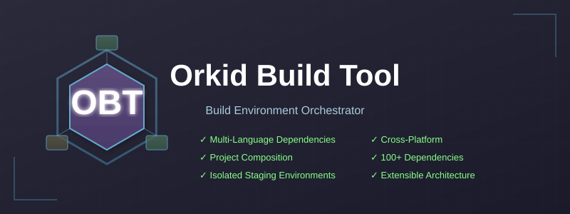

# OBT (Orkid Build Tool)



**Build environment orchestrator for complex multi-language projects**

[](https://www.python.org/downloads/)
[](https://opensource.org/licenses/BSD-3-Clause)
[](docs/obt_quickstart.md)

---

## What is OBT?

OBT manages build environments for complex software projects with extensive dependency trees. Unlike package managers that install system-wide, OBT creates isolated staging environments where all your project dependencies coexist without polluting your system.

### Key Features

- 🔧 **100+ Pre-configured Dependencies** - Boost, Qt5, OpenCV, LLVM, and more
- 🎯 **Project Composition** - Combine multiple projects with `--project` arguments
- 🌍 **Cross-Platform** - Identical commands on Linux, macOS, and WSL2
- 🏗️ **Multi-Language** - C++, Python, Rust, JavaScript, and more
- 📦 **Isolated Environments** - No system pollution, everything in staging directories
- 🎨 **Extensible** - Add custom dependencies and modules per project

---

## Quick Start

```bash
# Install OBT
pip3 install ork.build

# Create environment
obt.env.create.py --stagedir ~/.obt-staging

# Launch with projects
obt.env.launch.py --stagedir ~/.obt-staging --numcores 16 \
  --project ~/projects/myproject \
  --project ~/projects/shared

# Build dependencies
obt.dep.build.py boost
obt.dep.build.py opencv
```

---

## Documentation

### Getting Started
- 📚 [**Quick Start Guide**](docs/obt_quickstart.md) - Get up and running in minutes
- 🎯 [**Examples**](docs/obt_examples.md) - Real-world usage patterns

### Reference
- 📖 [**Technical Design Document**](docs/obt_tdd.md) - Architecture, concepts, and FAQ
- 🏗️ [**Project Composition**](docs/obt_tdd.md#project-composition-flow) - How projects integrate

### Advanced Topics
- [Git fetch tokens](docs/git_fetch_tokens.md) - Private dependencies, SSH URLs and recursive submodules
- 🐳 [**Docker Support**](docs/obt_docker.md) - Containerized development environments
- 🔮 [**Subspaces**](docs/obt_subspaces.md) - Isolated execution environments
- ⚡ [**FPGA/Vivado**](docs/obt_fpga.md) - Hardware development support

---

## Requirements

- Python 3.10+
- Virtual environment (PEP-668 compliance)
- Clean base shell environment ([why?](docs/obt_quickstart.md#shell-environment-best-practices))

### Platform-Specific

**macOS:** Xcode, Homebrew  
**Linux:** Build essentials, sudo access  
**Windows:** WSL2 with Ubuntu

---

## Project Composition

Make any project OBT-aware by adding:

```
myproject/
├── obt.project/
│   ├── obt.manifest          # {"name": "myproject", "autoexec": "scripts/init_env.py"}
│   └── scripts/
│       └── init_env.py       # Environment setup script
```

Then compose multiple projects:

```bash
obt.env.launch.py --project project1 --project project2 --project project3
```

---

## Philosophy

OBT doesn't replace package managers or build systems - it orchestrates them. When you need a library, you need it. OBT ensures you get it with the right version, in the right place, without breaking anything else.

---

## Support

- **Issues:** [GitHub Issues](https://github.com/tweakoz/ork.build/issues)
- **Discussions:** [GitHub Discussions](https://github.com/tweakoz/ork.build/discussions)

---

## License

BSD 3-Clause License - See [LICENSE](LICENSE) and [license.rst](license.rst) for details.

Copyright (c) 2010-2024, Michael T. Mayers. All rights reserved.